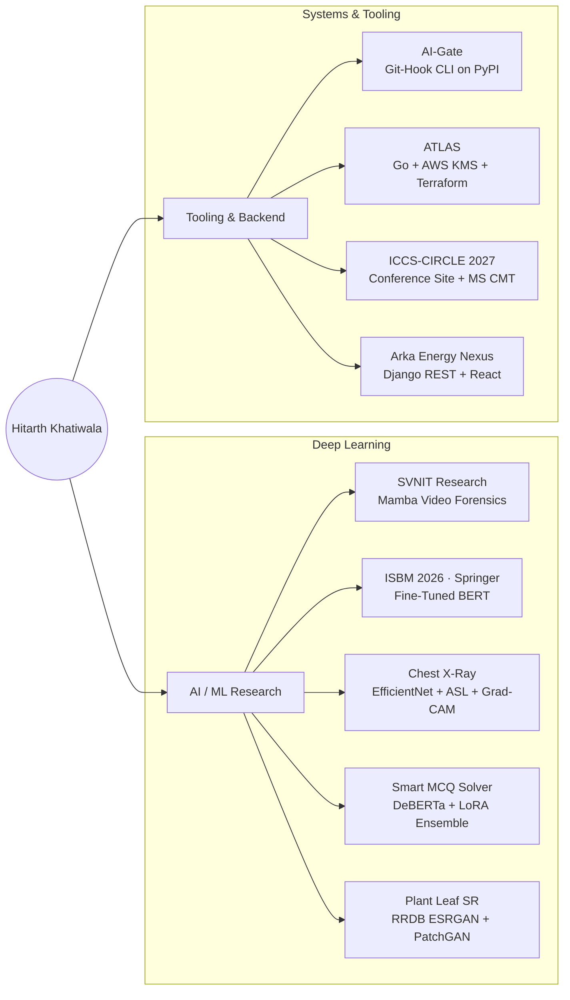

<div align="center">

<!-- HERO BANNER -->
<a href="https://github.com/hitarth1812">
  
</a>

<!-- ROLE BADGES -->
<p>
  
  
</p>

<p>
  <code>BTech AI &amp; ML @ CSPIT, CHARUSAT</code> &nbsp;•&nbsp; <code>BS Data Science &amp; Applications @ IIT Madras</code>
</p>

<!-- TYPING LINES -->
<a href="https://github.com/hitarth1812">
  
</a>

<br/><br/>

<!-- LINKS -->
<p>
  <a href="https://www.linkedin.com/in/hitarth-khatiwala"></a>
  <a href="https://huggingface.co/hitarth1812"></a>
  <a href="https://pypi.org/project/aigate-lite/"></a>
  <a href="mailto:hitarthkhatiwala@gmail.com"></a>
</p>

</div>

---

## `whoami`

```yaml
name:      Hitarth Khatiwala
location:  Surat, Gujarat, India
focus:     Deep learning research · Static analysis for AI-written code · Backend systems

education:
  ├─ BTech, AI & ML               ──► CSPIT, CHARUSAT   (Expected 2028 · CGPA 8.02 · First-year class topper)
  └─ BS, Data Science & Apps      ──► IIT Madras        (Expected 2028)

experience:
  ├─ UGSF Scholar, PDPIAS         ──► CHARUSAT          (2026 – Present)
  ├─ Backend Developer Intern     ──► Dezai AI          (Jun – Oct 2026)
  └─ AI/ML Research Intern        ──► SVNIT, Surat      (May – Jul 2026 · Image Forensics)

now:
  ├─ Manuscript on Mamba-based video deepfake detection (SVNIT work)
  ├─ AI-Gate: commit gate for AI-generated code, published on PyPI
  └─ ATLAS: Go engineering-intelligence platform (co-founded, in development)
```

### Research & Engineering Map



---

## Publications & Patents

<table>
  <tr>
    <td width="100%">
      
      <h3>Mental Health Analysis using Fine Tuned BERT Based Text Classification Model</h3>
      <p>
        <b>H. Khatiwala</b>, P. Jotania, M. Joshi, M. Patel, H. Jayswal, et al. &nbsp;•&nbsp; <i>5th World Conference on Information Systems for Business Management (<b>ISBM 2026</b>), Bangkok, Thailand · Sep 2026</i><br/>
        Fine-tuned BERT on three combined mental-health corpora, reaching up to <b>98.2% accuracy</b> on Twitter data. Presented at the conference and selected for the Springer Nature proceedings.
      </p>
      <p>
        
        
        
      </p>
    </td>
  </tr>
  <tr>
    <td width="100%">
      
      <h3>Modular Augmented Reality Drone Pilot Assistance System with 3D UAV Visualization and Non-Invasive Overlay Rendering</h3>
      <p>
        M. J. Panchal, K. K. Singh, <b>H. Khatiwala</b>, et al. &nbsp;•&nbsp; <i>Indian Patent Application No. 202621082775 A · Sep 2026</i><br/>
        Published in The Patent Office Journal No. 39/2026 (applicant: CHARUSAT).
      </p>
      <p>
        
        
      </p>
    </td>
  </tr>
</table>

---

## Research & Flagship Work

<table>
  <tr>
    <td width="50%" valign="top">
      <h3>Video Deepfake Forensics &nbsp; </h3>
      <p><b>Mamba-based spatio-temporal forgery detection</b> · May – Jul 2026</p>
      <ul>
        <li><b>Model:</b> Developed a Mamba (state-space model) spatio-temporal architecture for video deepfake-forgery detection.</li>
        <li><b>Evaluation:</b> Built a leakage-free, identity-disjoint protocol with baselines, ablations, and cross-dataset testing.</li>
        <li><b>Output:</b> Manuscript in preparation for conference submission.</li>
      </ul>
      <p>
        <code>PyTorch</code> <code>Mamba / SSMs</code> <code>Video Forensics</code> <code>OpenCV</code> <code>CUDA</code>
      </p>
    </td>
    <td width="50%" valign="top">
      <h3>ATLAS &nbsp; </h3>
      <p><b>Engineering-intelligence platform with a Go backend</b></p>
      <ul>
        <li><b>Staged Go backend:</b> modular services built stage by stage with constructor injection, no globals, and a stdlib-first approach.</li>
        <li><b>Auth & keys:</b> JWT issuance with signing keys stored in <b>AWS KMS</b> and <b>AWS Secrets Manager</b>.</li>
        <li><b>Infrastructure:</b> environments defined in <b>Terraform</b>, with integration tests gated behind build tags.</li>
      </ul>
      <p>
        <code>Go</code> <code>PostgreSQL</code> <code>AWS KMS</code> <code>Secrets Manager</code> <code>Terraform</code> <code>Docker</code>
      </p>
    </td>
  </tr>
</table>

---

## Featured Projects

<table>
<tr>
<td width="50%" valign="top">

### [AI-Gate (aigate-lite)](https://github.com/hitarth1812/AI-Gate)
**Commit gate that catches mistakes in AI-written code before they are committed.**
- **Zero-dependency CLI:** installs as a git hook with one `pip install`.
- **What it blocks:** hallucinated packages, weakened tests, and leaked secrets.
- **Analysis:** AST/lexer checks for `Python`, `Go`, and `JS/TS`, verified by **1,000+ tests** on cross-platform CI.

```bash
pip install aigate-lite
```

<p>
  <a href="https://github.com/hitarth1812/AI-Gate"></a>
  <a href="https://pypi.org/project/aigate-lite/"></a>
</p>

</td>
<td width="50%" valign="top">

### [Multi-Label Chest X-Ray Classification](https://github.com/hitarth1812/X-ray-pathology-classifier)
**Multi-label thoracic disease classification across 20 classes (51K images).**
- **Model:** `EfficientNet-B0` with transfer learning.
- **Class imbalance:** Asymmetric Loss to handle a **6,815×** imbalance between classes.
- **Results:** **0.8114 validation AUC**, with **Grad-CAM** heatmaps in a live Gradio demo.

> Research and educational use only; not a diagnostic tool.

<p>
  <a href="https://huggingface.co/spaces/hitarth1812/chest-xray-classifier"></a>
  <a href="https://github.com/hitarth1812/X-ray-pathology-classifier"></a>
</p>

</td>
</tr>
<tr>
<td width="50%" valign="top">

### [Smart MCQ Solver](https://github.com/hitarth1812/24f2001535-dl-genai-project)
**Ranked MCQ prediction for an IIT Madras Kaggle competition.**
- **Models:** from-scratch Transformer, `BERT + LoRA`, and `DeBERTa-v3 + LoRA`.
- **Ensemble:** Nelder-Mead weighted averaging plus a logistic-regression stacker.
- **Results:** **0.8012 offline MAP@3**, **0.748** on the Kaggle leaderboard; experiments tracked in W&B.

<p>
  <a href="https://github.com/hitarth1812/24f2001535-dl-genai-project"></a>
  
</p>

</td>
<td width="50%" valign="top">

### [Plant Leaf Image Enhancement GAN](https://github.com/hitarth1812/Plants_Super_Resolution)
**4× ESRGAN-style super-resolution for plant leaf images.**
- **Architecture:** 16-block **RRDB** generator with a **PatchGAN** discriminator.
- **Loss:** L1 pixel loss, VGG19 perceptual loss, and a tuned adversarial weight.
- **Training:** pixel warm-up, then adversarial training, with cosine LR, `AMP`, and **8-fold TTA** at inference.

<p>
  <a href="https://github.com/hitarth1812/Plants_Super_Resolution"></a>
  
</p>

</td>
</tr>
<tr>
<td width="50%" valign="top">

### ICCS-CIRCLE 2027 Conference Website
**Official site for a research conference hosted by PDPIAS, CHARUSAT (UGSF scholarship work).**
- **Build:** `HTML/CSS/JS` frontend with a `Node.js/Express` server and a Google Sheets backend.
- **Peer review:** set up **Microsoft CMT** for paper submission and double-blind review, and integrated it into the site.

<p>
  
</p>

</td>
<td width="50%" valign="top">

### [Arka Energy Nexus](https://github.com/hitarth1812/arka-energy-nexus)
**Energy-audit and ESG reporting platform.**
- **Data ingestion:** parses pivot-formatted utility spreadsheets into structured records.
- **Carbon accounting:** Scope-2 emissions using India's CEA grid factor (**0.82 kg CO₂/kWh**).
- **Dashboard:** `React` dashboard with a 3D globe and one-click PDF reports via `ReportLab`.

<p>
  <a href="https://github.com/hitarth1812/arka-energy-nexus"></a>
  
</p>

</td>
</tr>
</table>

> **Also:** **[Crack Detection](https://github.com/hitarth1812/Crack-Detection)**: `EfficientNet-B0` + `Grad-CAM` concrete crack classification, **99.72% test accuracy**.

---

## Experience

| Role | Organisation | Period | Highlights |
| :-- | :-- | :-- | :-- |
| **UGSF Scholar**, PDPIAS | CHARUSAT · Changa | 2026 – Present | Built the ICCS-CIRCLE 2027 conference website; configured and integrated Microsoft CMT for double-blind review. |
| **Backend Developer Intern** | [Dezai AI](https://dezai.org) · Remote | Jun – Oct 2026 | Built and validated production backend features (`Next.js`, `Node.js`) for RBAC, file uploads, and audit logging; wrote 40+ QA test cases and validation reports. |
| **AI/ML Research Intern**, Image Forensics | SVNIT, Surat · Hybrid | May – Jul 2026 | Mamba-based spatio-temporal deepfake detection; identity-disjoint evaluation with ablations and cross-dataset tests. |

---

## Tech Stack

<div align="center">

| Layer | Technologies |
| :---: | :---: |
| **Languages** |  |
| **AI / Deep Learning** |  <br/>      |
| **Backend & Cloud** |  |
| **Tools & MLOps** |  <br/>     |

</div>

---

## GitHub Activity

<div align="center">


<br/>


</div>

---

<div align="center">

**Open to:** research collaborations in deep learning and forensics · applied ML and backend internships

<a href="https://github.com/hitarth1812">
  
</a>

</div>
