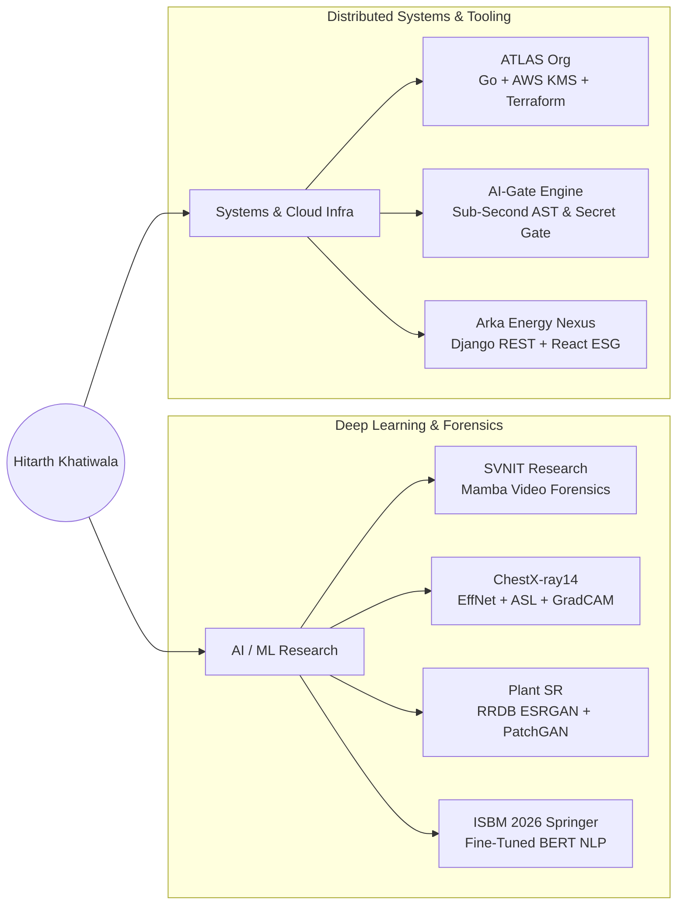

<div align="center">

<!-- 100% UPTIME HERO BANNER (POWERED BY DEMOLAB SVG ENGINE — ZERO VERCEL DOWNTIME) -->
<a href="https://github.com/hitarth1812">
  
</a>

<!-- SUBTITLE BANNER BAR -->
<p>
  
  
</p>

<p>
  <code>BTech AI/ML @ CSPIT, CHARUSAT</code> &nbsp;•&nbsp; <code>BS Data Science &amp; Applications @ IIT Madras</code>
</p>

<!-- DYNAMIC TYPING TERMINAL (CALIBRATED WIDTH — ZERO CLIPPING) -->
<a href="https://github.com/hitarth1812">
  
</a>

<br/><br/>

<!-- CORE CREDENTIALS & LINKS -->
<p align="center">
  <a href="https://www.linkedin.com/in/hitarth-khatiwala-926b69318"></a>
  <a href="https://github.com/hitarth1812"></a>
  <a href="https://huggingface.co/hitarth1812"></a>
  <a href="mailto:hitarthkhatiwala@gmail.com"></a>
  
</p>

</div>

---

## `neofetch --engineer hitarth`

```yaml
OS:        HitarthOS v2026.11 (x86_64 / CUDA 12.x)
Host:      Surat, Gujarat, India
Kernel:    Deep Learning Research & Distributed Go Backends

Active Ventures & Research:
  ├─ ATLAS (Co-Founded Org)  ──► Lead Systems Architect (Go, AWS KMS, Secrets Manager, Terraform)
  └─ SVNIT (Research Intern) ──► Video Deepfake Forensics via State-Space Models (Mamba)

Previous Experience:
  └─ Dezai AI                ──► Backend Developer Intern (Go, Python, FastAPI, AWS)

Concurrent Dual Degree:
  ├─ BTech in AI & ML        ──► CSPIT, CHARUSAT
  └─ BS in Data Science      ──► IIT Madras

Engineering & Research Domains:
  ├─ [Track 01 · AI/ML Research]   State-Space Models (Mamba) · Video Forensics · Medical CV · Clinical NLP
  └─ [Track 02 · Systems & Infra]  Staged Go Microservices · Zero-Trust AWS KMS/IaC · Deterministic AST Gates
```

### Research & Engineering Ecosystem



---

## Peer-Reviewed Publication

<table>
  <tr>
    <td width="100%">
      
      <h3>Mental Health Analysis using Fine-Tuned BERT-Based Text Classification Model</h3>
      <p>
        <b>Lead Author</b> &nbsp;•&nbsp; <i>5th World Conference on Information Systems for Business Management (<b>ISBM 2026</b>), Bangkok, Thailand</i><br/>
        Engineered a domain-adapted transformer pipeline for nuanced psychological state classification from unstructured text, addressing class skewness and contextual ambiguity in clinical NLP.
      </p>
      <p>
        
        
        
      </p>
    </td>
  </tr>
</table>

---

## Flagship Initiatives & Research in Flight

<table>
  <tr>
    <td width="50%" valign="top">
      <h3>ATLAS &nbsp; </h3>
      <p><b>Distributed Engineering-Intelligence Platform & Backend Ecosystem</b></p>
      <ul>
        <li><b>Organization & Vision:</b> Co-created independent engineering organization building high-security developer & system intelligence infrastructure.</li>
        <li><b>Staged Go Architecture:</b> Designed modular, low-latency backend services in <code>Go</code> with strict domain boundaries.</li>
        <li><b>Zero-Trust Security:</b> Custom JWT authentication pipelines backed by hardware-grade cryptographic key rotation via <b>AWS KMS</b> and <b>AWS Secrets Manager</b>.</li>
        <li><b>Cloud Provisioning:</b> Declarative, reproducible multi-stage cloud infrastructure managed end-to-end with <b>Terraform IaC</b>.</li>
      </ul>
      <p>
        <code>Go</code> <code>AWS KMS</code> <code>Secrets Manager</code> <code>Terraform</code> <code>PostgreSQL</code> <code>Docker</code>
      </p>
    </td>
    <td width="50%" valign="top">
      <h3>Video Deepfake Forensics &nbsp; </h3>
      <p><b>State-Space Models (Mamba) for Spatio-Temporal Forgery Detection</b></p>
      <ul>
        <li><b>Research Problem:</b> Standard ViTs suffer from quadratic complexity across long video sequences, missing subtle inter-frame manipulation artifacts.</li>
        <li><b>Mamba Backbone:</b> Designing linear-time selective State-Space Models (SSMs) to track long-range temporal and frequency-domain inconsistencies across compressed video streams.</li>
        <li><b>Forensic Generalization:</b> Evaluating cross-manipulation robustness against unseen diffusion and GAN-based face-swapping/reenactment generators.</li>
      </ul>
      <p>
        <code>PyTorch</code> <code>Mamba / SSMs</code> <code>Video Forensics</code> <code>OpenCV</code> <code>CUDA</code>
      </p>
    </td>
  </tr>
</table>

---

## Engineered Systems & Production Repositories

<table>
<tr>
<td width="50%" valign="top">

### [AI-Gate](https://github.com/hitarth1812)
**Sub-second static analysis & deterministic code-review engine for developers and AI agents.**
- **Zero-Bloat Core:** Single-file, high-concurrency engine delivering **sub-second feedback loops** across `Python`, `Go`, and `JavaScript` codebases.
- **Security & Supply-Chain Auditing:** Automated hardcoded secret detection, dependency vulnerability scanning, and structural AST verification.
- **Agentic Guardrails:** Purpose-built as a cost-optimized, deterministic quality gate for autonomous AI coding agents and CI/CD pull-request pipelines.

<p>
  <a href="https://github.com/hitarth1812"></a>
  
</p>

</td>
<td width="50%" valign="top">

### [X-Ray Pathology Classifier](https://github.com/hitarth1812/X-ray-pathology-classifier)
**Multi-label thoracic disease diagnosis across 20 pathologies (NIH ChestX-ray14).**
- **Model Architecture:** `EfficientNet-B0` feature extractor paired with a custom two-layer MLP classification head.
- **Extreme Imbalance Mitigation:** Engineered Asymmetric Loss with square-root positive weight scaling (`√pos_weight`) to overcome a **6,815×** class imbalance.
- **Clinical Explainability:** Two-phase transfer learning (`AMP` on Tesla T4) reaching **0.8114 Val Macro-AUC** with localized **GradCAM** heatmaps.

<p>
  <a href="https://huggingface.co/spaces/hitarth1812/chest-xray-classifier"></a>
  <a href="https://github.com/hitarth1812/X-ray-pathology-classifier"></a>
</p>

</td>
</tr>
<tr>
<td width="50%" valign="top">

### [Plant Super-Resolution GAN](https://github.com/hitarth1812/Plants_Super_Resolution)
**ESRGAN perceptual super-resolution pipeline built for high-frequency botanical recovery.**
- **Generator / Discriminator:** Deep Residual-in-Residual Dense Block (**RRDB**, 16–23 blocks) generator coupled with a PatchGAN discriminator.
- **Perceptual Optimization:** Multi-objective loss combining L1 pixel fidelity, VGG-19 feature activation loss, and tuned adversarial weight (`λ = 0.001`).
- **Curriculum & Inference:** 3-stage training (PSNR warmup → GAN → fine-tune) with cosine LR scheduling and **8-fold Test-Time Augmentation (TTA)**.

<p>
  <a href="https://github.com/hitarth1812/Plants_Super_Resolution"></a>
  
</p>

</td>
<td width="50%" valign="top">

### [Arka Energy Nexus](https://github.com/hitarth1812/arka-energy-nexus)
**Full-stack enterprise energy auditing & automated ESG intelligence platform.**
- **AI Audit Parser:** Intelligent ingestion pipeline that normalizes complex, pivot-formatted Excel utility spreadsheets into structured relational models.
- **Carbon Accounting Engine:** Automated Scope-2 emissions calculator calibrated to India's CEA grid factor (**0.82 kg CO₂/kWh**).
- **Executive Telemetry:** Interactive 3D WebGL globe dashboard (`React` + `Framer Motion`) with one-click PDF compliance reports via `ReportLab`.

<p>
  <a href="https://github.com/hitarth1812/arka-energy-nexus"></a>
  
</p>

</td>
</tr>
</table>

> **Additional Selected Work:** **[Crack Detection (99.72% Test Acc)](https://github.com/hitarth1812/Crack-Detection)** — `EfficientNet-B0` + `GradCAM` structural defect localization &nbsp;|&nbsp; **[Imbalanced Comment Category NLP](https://github.com/hitarth1812)** — Class-weighted Transformer pipeline (`Macro F1 ≈ 0.62`).

---

## Technical Arsenal

<div align="center">

| Layer | Core Technologies |
| :---: | :---: |
| **Languages & Systems** | <a href="https://skillicons.dev"></a> |
| **AI / Deep Learning** | <a href="https://skillicons.dev"></a> <br/>      |
| **Cloud, Backend & Web** | <a href="https://skillicons.dev"></a> |
| **Research & DevOps** | <a href="https://skillicons.dev"></a> <br/>   |

</div>

---

## GitHub Telemetry & Contribution Velocity

<div align="center">

<picture>
  
</picture>
<picture>
  
</picture>

<br/>

<picture>
  
</picture>
<picture>
  
</picture>

<br/>

<picture>
  
</picture>

</div>

---

<div align="center">

**Open to:** Deep Learning Research Collaborations · Applied ML & Distributed Systems Roles · State-Space & Forensics Discussions

<a href="https://github.com/hitarth1812">
  
</a>

</div>
